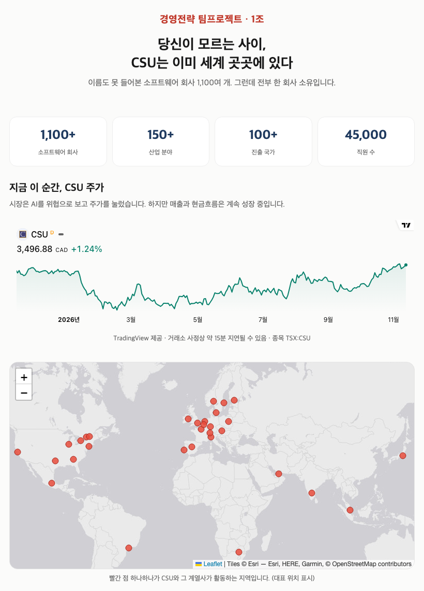

# 당신이 모르는 사이, CSU는 세계에 있다

캐나다의 소프트웨어 지주회사 **Constellation Software(TSX: CSU)**를 소개하는 한 페이지짜리 웹사이트입니다.
경영전략 수업 팀 프로젝트(1조) 발표에서, 청중이 발표 시작 전에 QR 코드로 접속해 회사 정보와 발표 자료를 함께 볼 수 있도록 만들었습니다.

**사이트: https://jun-jade.vercel.app**



## 메시지

CSU는 이름도 잘 알려지지 않은 산업별 소프트웨어 회사 1,100여 곳을 인수해 거느리고 있습니다. 시내버스 배차, 수도요금 고지서, 병원 전자의무기록처럼 **우리가 매일 쓰지만 보이지 않는 곳**에 CSU의 소프트웨어가 있다는 점을 보여 주는 것이 목표입니다.

## 구성

| 섹션 | 내용 |
|---|---|
| 규모 | 소프트웨어 회사 수, 산업 분야, 진출 국가, 직원 수 |
| 실시간 주가 | TradingView 위젯으로 TSX:CSU 주가 표시 (약 15분 지연) |
| 세계 지도 | 본사(토론토)와 계열사가 활동하는 대표 지역 34곳 (Leaflet) |
| 분야별 카드 | 대중교통, 골프장, 피트니스, 건설, 수도·전기 요금, 병원, 교육, 금융, 통신, 농식품 10개 분야. 카드를 누르면 대표 계열사가 펼쳐지고, 회사 이름을 누르면 실제 회사 사이트로 이동합니다 |
| 자료 | 발표 PDF와 출처 모음(Notion) 링크 |

계열사는 CSU의 운영 그룹(Volaris, Harris, Jonas, Modaxo, Vencora, Lumine, Cultura) 공개 포트폴리오에서 고른 대표 예시입니다.

## 파일

```
├── index.html     사이트 전체 (HTML·CSS·JS 한 파일)
├── csu_ppt.pdf    발표 자료
└── docs/          README용 화면 캡처
```

빌드 과정 없이 `index.html`을 브라우저로 열면 바로 동작합니다. 배포는 Vercel 정적 호스팅을 사용합니다.

## 사용한 것

- [Leaflet](https://leafletjs.com/) + Esri Light Gray Canvas 지도 타일
- [TradingView](https://www.tradingview.com/widget/) Mini Symbol Overview 위젯

## 출처

규모 수치와 회사 정보는 [Constellation Software 공식 사이트](https://www.csisoftware.com/)와 [Wikipedia](https://en.wikipedia.org/wiki/Constellation_Software)(2025~2026년 기준)를 참고했습니다. 직원 수 등은 출처와 시점에 따라 차이가 있습니다. 지도의 점은 알려진 활동 지역을 대표로 표시한 것입니다.
